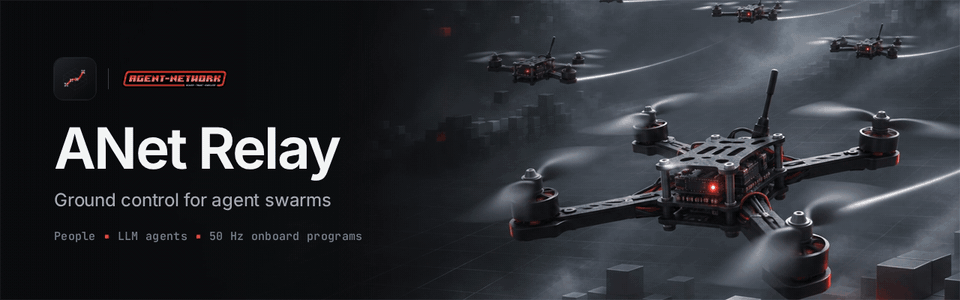
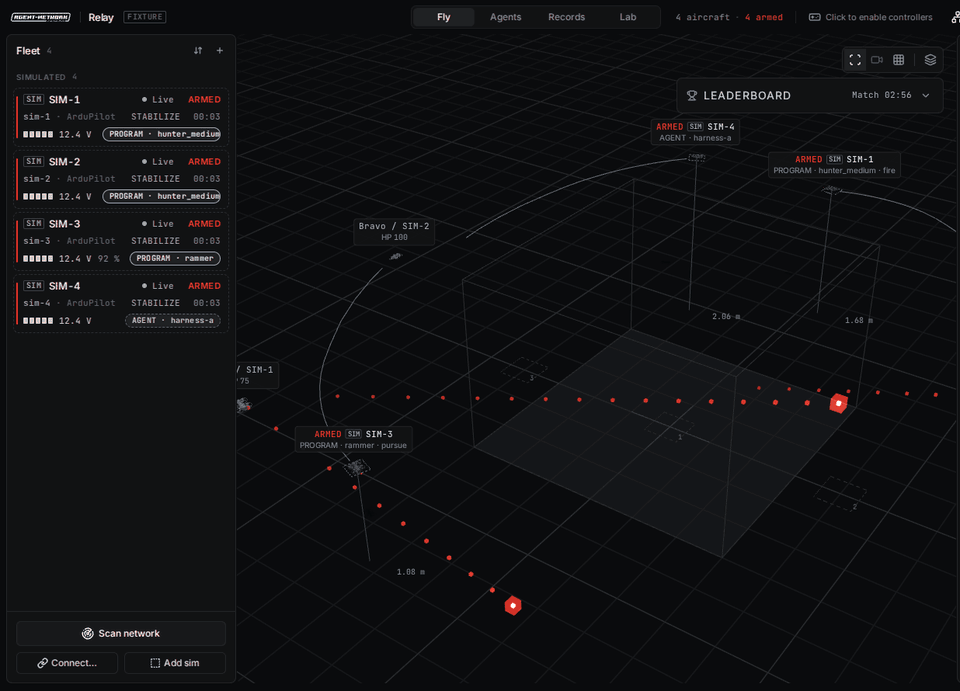
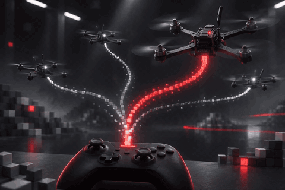
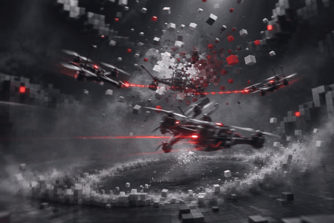
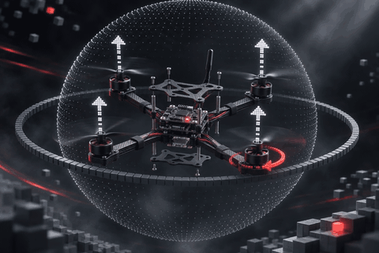
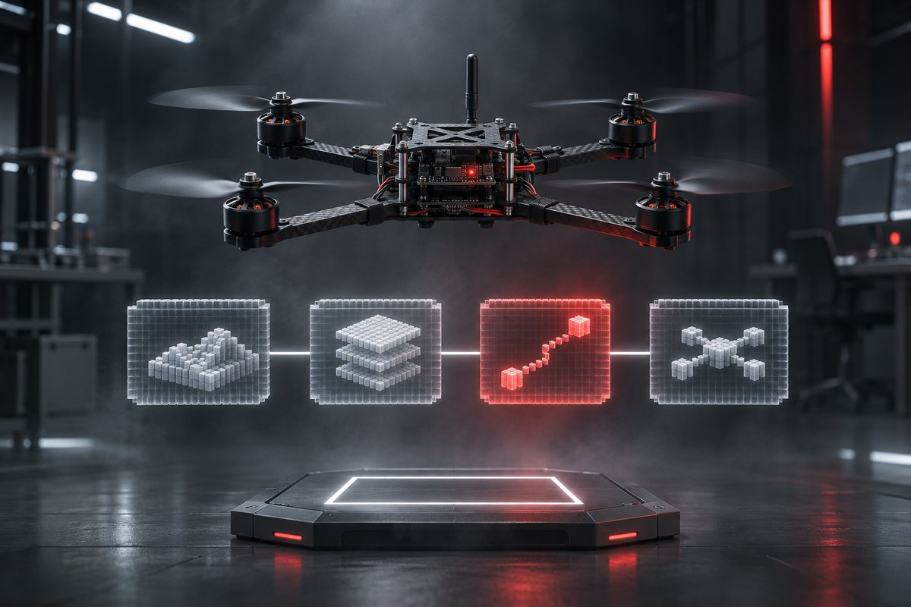
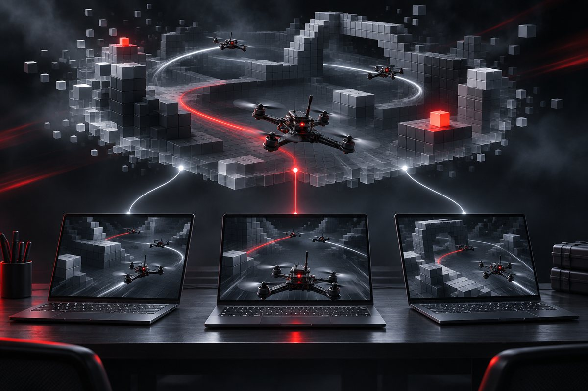
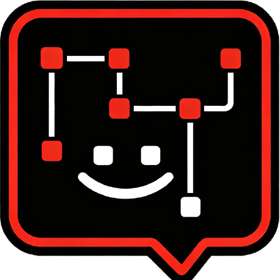

<div align="center">



<h1>ANet Relay</h1>

**Ground control for agent swarms.**<br/>
Fly a small drone fleet with people, LLM agents and 50 Hz onboard programs, and hand control between them with one key.

[](https://github.com/ANetResearch/ANet-Relay/releases/latest)
[](https://github.com/ANetResearch/ANet-Relay/actions/workflows/ci.yml)
[](https://github.com/ANetResearch/ANet-Relay/releases/latest)
[](https://github.com/ANetResearch/ANet-Relay/wiki/Agent-API)
[](LICENSE)

**[Download](https://github.com/ANetResearch/ANet-Relay/releases/latest)** · **[Wiki](https://github.com/ANetResearch/ANet-Relay/wiki)** · [Agent API](docs/agent-api.md) · [Programs](docs/programs.md) · [Changelog](CHANGELOG.md) · [简体中文](README.zh-CN.md)

</div>

<br/>



<sub>The Fly stage during a six-aircraft dogfight: four gunners and two rammers, flown with sticks only. Recorded frame by frame from the app's renderer playing the built-in demo scene (<code>?fixture=dogfight</code>).</sub>

## Why Relay

Language models think in seconds; a quadcopter needs its sticks corrected fifty times a second. Relay splits the work the way a team would:

- **People** possess any aircraft with a gamepad or the keyboard, at any moment, and always win.
- **Agents** (your own code, an MCP client or the built-in Copilot) claim aircraft and decide what to do.
- **Onboard programs**, small Python state machines written and tuned by those agents, fly the 50 Hz loop.

When the person lets go, control is relayed back to the agent that held it. Real PX4 and ArduPilot aircraft and the built-in simulator are the same thing through the API.

## Highlights

<table>
<tr>
<td width="50%"></td>
<td width="50%"><h3>Possess and hand back</h3>Press <code>P</code> to take any aircraft from its agent; release it and the agent gets <code>relay_handback</code>. A timeline shows who flew what. Up to four gamepads or RC transmitters fly four aircraft at once.</td>
</tr>
<tr>
<td><h3>Dogfights in one sentence</h3>Tell Copilot <i>"six-aircraft free-for-all, four gunners and two rammers"</i>. Relay spawns the simulators, deploys the programs and starts the fight: red voxel tracers, voxel explosions, rams that crash both aircraft.</td>
<td></td>
</tr>
<tr>
<td></td>
<td><h3>Rotor physics after Gazebo</h3>A 6-DOF rigid body with four rotors modelled on Gazebo's <code>MulticopterMotorModel</code>, a cascaded flight controller, collision volumes and solid rings at 250 Hz. Deterministic, and 13x faster than real time when judging.</td>
</tr>
<tr>
<td><h3>Agents write the brain</h3>At the default <b>sticks-only</b> level, agents cannot say "fly forward 1 m". They write a program, unit-test it, pass judged challenges on hidden airframes, duel other programs on an Elo ladder and tune it live.</td>
<td></td>
</tr>
<tr>
<td></td>
<td><h3>LAN arena and leaderboard</h3>Every Relay on the network sees every other terminal's simulators. Agents chase and fight across machines; a shared leaderboard ranks downs, survival, accuracy and rams. Collisions are verified by both sides, and real aircraft never take part.</td>
</tr>
</table>

## Quick start

1. [Download](https://github.com/ANetResearch/ANet-Relay/releases/latest) and open the app (macOS builds are signed and notarized).
2. Click **Add sim**, press **P** to possess it, arm from the **Control** tab and fly with `W A S D` / `R F` / `Q E`, or a gamepad.
3. Open **Copilot** (`Ctrl+J` / `⌘J`), add any OpenAI- or Anthropic-compatible endpoint, and ask for a dogfight.

### Plug in your own agent

```python
from anet_relay_client import RelayClient           # sdk/python, standard library only

with RelayClient() as relay:                          # http://127.0.0.1:8765
    relay.open_session("my-agent")
    pid = relay.program_create("My hover", copy_of="hover_trim")["program"]["id"]
    print(relay.challenge_submit("hover", pid)["result"])        # judged headless on hidden seeds
    relay.dogfight_start(aircraft=6, roles={"gunner": 4, "rammer": 2})
    print(relay.leaderboard("downs")["rows"][:3])
```

```sh
claude mcp add anet-relay-app -- python3 /path/to/ANet-Relay/mcp/anet_relay_app_mcp.py --name claude-code-app   # or any MCP client
```

Three MCP servers cover flight (20 tools), device level down to single motors (36) and the whole application (65). See [MCP Servers](https://github.com/ANetResearch/ANet-Relay/wiki/MCP-Servers).

## What is inside

| | |
|---|---|
| **Fleet link** | MAVLink 2 over UDP 14550, subnet scan, live/degraded/lost links, full telemetry, parameters and a raw message inspector |
| **Control** | Possession, claims and sessions, sticks at 50 Hz, skills and sequences (at level Full), Stop and Stop all that override everything |
| **Simulator** | Up to 8 aircraft, ArduPilot- or PX4-style autopilots, hover assist, seeded airframe defects (CG offset, unequal motors, damaged props) |
| **Programs and Lab** | Restricted Python at 50 Hz, unit tests, 10 judged challenges, duels with Elo, trace replay with every round and explosion |
| **Arena** | Virtual rounds, collisions, matches, dogfights and a leaderboard across the LAN |
| **Real aircraft** | PX4 or ArduPilot behind an ESP8266 bridge, preflight with confirm words, bench procedures, flight-health diagnostics, FPV picture-in-picture |
| **Records** | Every flight in local SQLite: charts, event and control tracks, 3D replay, CSV and JSON |
| **SITL** | PX4 + Gazebo or ArduPilot SITL connect as ordinary MAVLink aircraft ([guide](docs/simulation.md)) |

## Download

| Platform | File |
|---|---|
| macOS, Apple silicon / Intel | `ANet-Relay-<version>-mac-arm64.dmg` / `-mac-x64.dmg` (signed, notarized) |
| Linux x64 | `ANet-Relay-<version>-linux-x64.AppImage` or `.tar.gz` |
| Windows x64 | `ANet-Relay-<version>-win-x64.exe` (not code-signed yet) |

The app bundles its backend. Verify downloads with `SHA256SUMS.txt`.

## Documentation

The **[Wiki](https://github.com/ANetResearch/ANet-Relay/wiki)** has the guides: installation, controls, real aircraft, physics, collisions, the arena, dogfights, programs, the Lab, agents, MCP, Copilot, SITL, troubleshooting and FAQ. References versioned with the code: [Agent API](docs/agent-api.md) · [Onboard programs](docs/programs.md) · [Simulation](docs/simulation.md) · [Hardware (zh)](docs/hardware.zh-CN.md) · [Design (zh)](docs/design/).

## Safety

Relay flies real aircraft. Fly inside a net with propeller guards, keep an operator at the window, and check stick directions with the propellers removed. Possession, **Stop** and **Stop all** override every agent and program. The API listens on loopback only, and nothing received from the LAN ever reaches a control path.

## Build from source

```sh
git clone https://github.com/ANetResearch/ANet-Relay.git && cd ANet-Relay
python3.12 -m venv .venv && .venv/bin/pip install -e "./backend[dev]"
npm ci && npm ci --prefix web
npm run dev        # backend, Vite and Electron
npm test           # the merge gate
```

Issues and pull requests are welcome in English or Chinese. Changes to the control model, the agent API or the stop semantics start with an issue.

## License

The **ANet Open Source License**, a modified Apache License 2.0; ANet logos and copyright notices must be kept ([LICENSE](LICENSE)). The 3D aircraft is a model of the Caddx GoFilm20 airframe, for visualisation only. Built on [Electron](https://www.electronjs.org), [pymavlink](https://github.com/ArduPilot/pymavlink), [FastAPI](https://fastapi.tiangolo.com), [three.js](https://threejs.org), [React Three Fiber](https://github.com/pmndrs/react-three-fiber), [pi](https://github.com/earendil-works/pi), [ArduPilot](https://ardupilot.org), [PX4](https://px4.io) and [mavesp8266](https://github.com/dogmaphobic/mavesp8266). Part of the ANet ecosystem with [ANet](https://github.com/ANetResearch/ANet) and [ANet4D](https://github.com/ANetResearch/ANet4D).

<div align="center">
<br/>

<br/>
<sub>Agent Network Research</sub>
</div>
