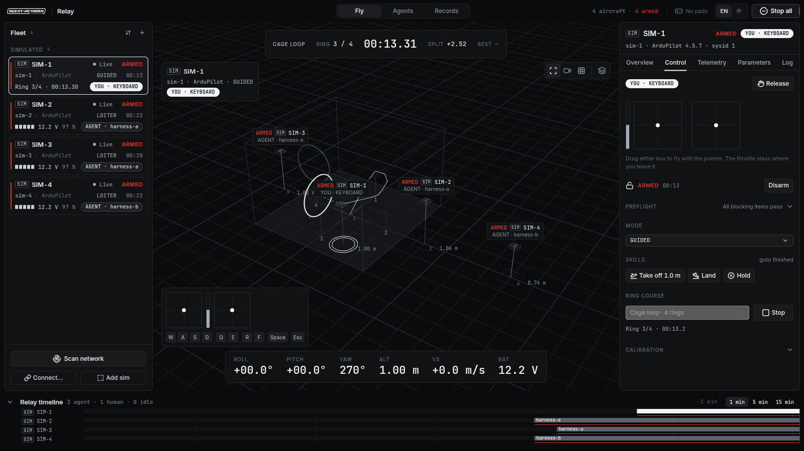
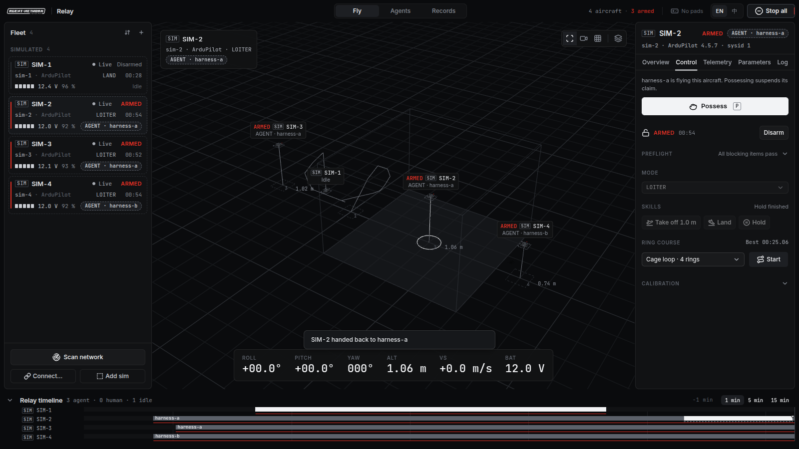
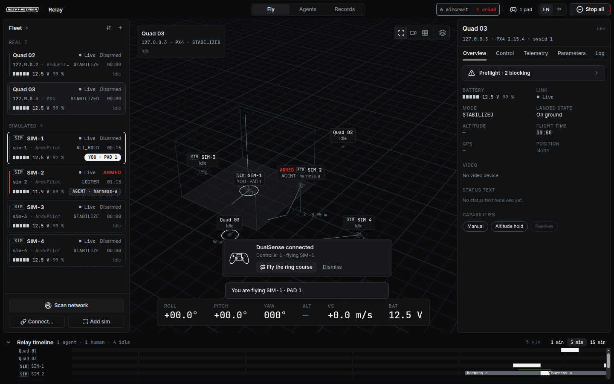
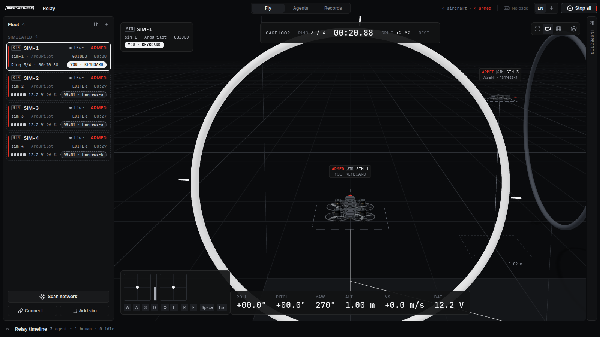
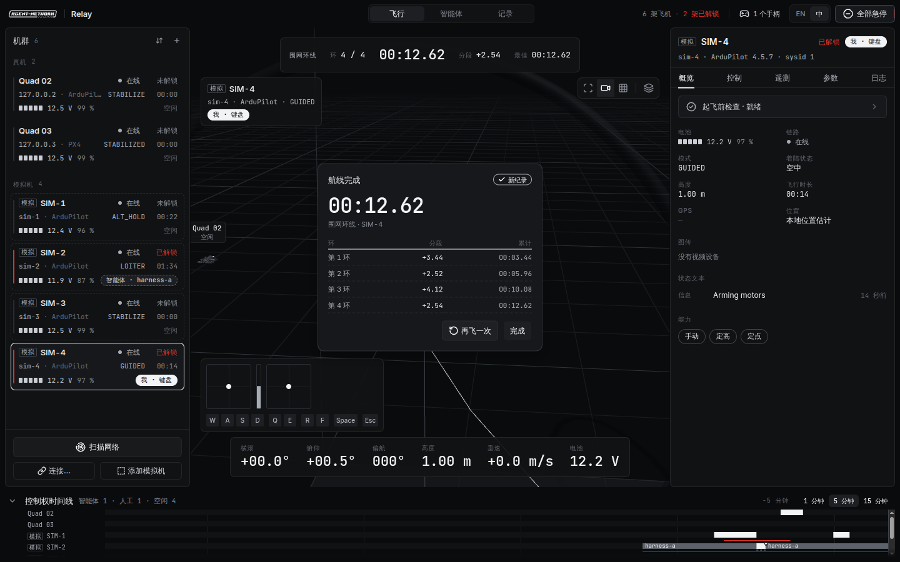
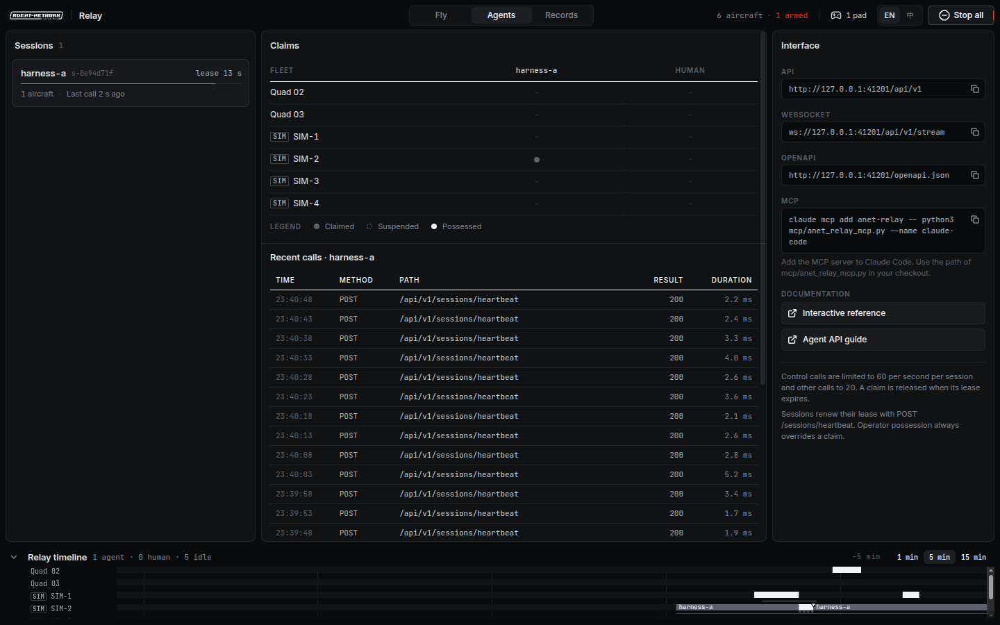
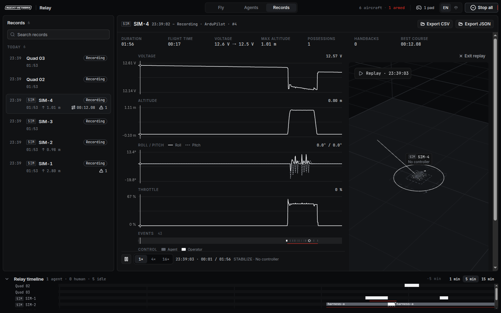
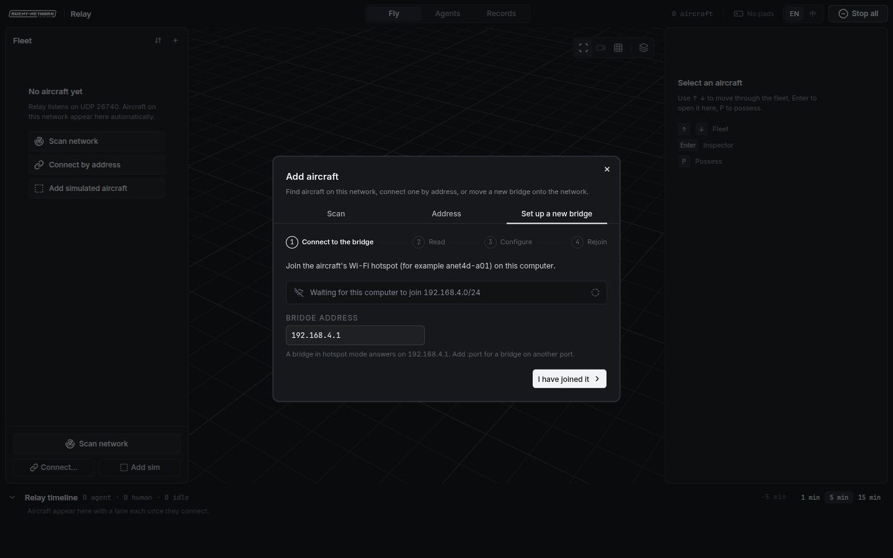

<div align="center">


<h3>ANet Relay</h3>

ANet Relay 是面向局域网 Wi-Fi 小型无人机机群的桌面地面站，为人与智能体协同飞行的团队而建。它对标 QGroundControl，面向智能体机群：发现并连接网络内的每一架 MAVLink 飞机，展示每架飞机上报的全部信息；操作员可以用手柄或键盘附身任意一架，外部智能体和大语言模型通过本机 API 飞其余各架。操作员松手后，控制权接力交还给原先持有它的智能体。内置模拟器和虚拟穿环航线让整个闭环无需硬件即可运行；具备位置估计的真机也可以穿越同一组虚拟环。

[](https://github.com/ANetResearch/ANet-Relay/releases/latest)
[](https://github.com/ANetResearch/ANet-Relay/actions/workflows/ci.yml)
[](https://github.com/ANetResearch/ANet-Relay/releases/latest)
[](docs/agent-api.zh-CN.md)
[](LICENSE)

**[下载](https://github.com/ANetResearch/ANet-Relay/releases/latest)** · **[智能体接口](docs/agent-api.zh-CN.md)** ·
[机载程序](docs/programs.zh-CN.md) ·
[硬件配置](docs/hardware.zh-CN.md) ·
[设计文档](docs/design/) ·
[更新日志](CHANGELOG.md) · [ANet4D](https://github.com/ANetResearch/ANet4D) · [ANet](https://github.com/ANetResearch/ANet)

[English](README.md) · **简体中文**

</div>

<br/>



<sub>**截图。** 四架模拟机。操作员用键盘驾驶 SIM-1 穿越围网环线第 3 环，智能体 `harness-a` 与 `harness-b` 控制其余三架。底部的控制权时间线显示过去一分钟内每架飞机由谁控制。</sub>

## 能力

| 能力 | 说明 | 状态 |
|---|---|---|
| 机群链路 | 基于 UDP 的 MAVLink 2：监听 14550，扫描本地子网，按地址连接；每架飞机一条链路，分在线、降级、丢失三种状态 | 可用 |
| 全量可见 | 姿态、高度、电池、GPS 与本地位置、模式、着陆状态、状态文本、原始 MAVLink 查看器、可检索可编辑的完整参数表、单机日志 | 可用 |
| 附身 | 用 DualSense 或标准手柄、键盘或屏幕摇杆接管任意一架；多个手柄可同时飞多架 | 可用 |
| 接力给智能体 | 附身始终优先，智能体的认领被挂起；松手后认领恢复，智能体收到 `relay_handback` | 可用 |
| 飞行动作与动作序列 | 在检查器中起飞、悬停、前后左右与升降平移、转向、降落，或编排成动作序列逐步执行；无定位源时在定高模式下也可使用（平移距离为开环估算） | 可用 |
| 智能体接口 | 本机 REST 与 WebSocket 接口：会话、认领、杆量、技能（起飞、降落、悬停、平移、转向、返航、前往、姿态、速度）、动作序列、按历史飞行再飞与事件；Python SDK；飞行、设备级、应用控制三套 MCP 服务 | 可用 |
| 设备级接口 | 细到单个电机与输出通道：设备总览、任意 MAVLink 消息、参数读写、原始指令目录、单电机测试、执行器、遥控通道覆盖、消息频率、重启、校准、home、飞行终止；危险操作需确认词 | 可用 |
| 应用控制 | 智能体可操作 Relay 本身：查看手柄与应用状态、切换中英文与工作区、选择飞机、扫描网络、管理机群与模拟机、修改设置、截图；可在设置中关闭 | 可用 |
| Copilot | 基于 [pi](https://github.com/earendil-works/pi) 的内置对话智能体，独立浮动窗口始终置顶、可拖到任意位置且不阻挡其他窗口；用自然语言完成飞行、设备级与应用操作；可配置任意 OpenAI 或 Anthropic 兼容的端点与 Key；真机的每个运动指令与设备写入都需操作员批准 | 可用 |
| 飞行健康 | 飞行中滚动诊断：姿态振荡、松杆倾斜、航向漂移、定高稳定性、悬停油门、电机均衡、振动、电池压降、链路与摇杆数据流，并给出可能原因与处理方法 | 可用 |
| 模拟器 | 最多 8 架模拟机，行为与 ArduPilot 或 PX4 飞机一致，含动力学与电池模型；通过接口看与真机完全相同 | 可用 |
| 物理模拟 | 每架模拟机可单独开关悬停辅助：关闭后如同一架没有气压计与定位源的穿越机（油门即推力，含地效、电机响应、湍流）；可在飞行中切换 | 可用 |
| 标定与测试 | 五个逐步执行的流程，从链路检查到传感器校准、电机顺序、振动、悬停与阶跃响应测试；给出实测判定、参数建议，并保存中英双语报告 | 可用 |
| 操控与遥控器 | 柔和、标准、运动三档手感，Mode 1 与 Mode 2，逐轴反向，USB 摇杆模式的遥控器与映射学习向导，驾驶状态 HUD | 可用 |
| 局域网联机 | 同一网络内的 Relay 终端互见彼此的模拟机，以共享弹道发射虚拟子弹、判定命中并计分；真机永不参与 | 可用 |
| 穿环航线 | 虚拟环序列（围网环线、绕桩、爬升），含计时、分段与追尾视角；模拟机可飞，具备本地位置估计的真机也可飞 | 可用 |
| 数传配网 | 四步向导，把新的 ESP8266 MAVLink 数传从自身热点迁移到团队网络 | 可用 |
| 起飞前检查 | 链路、飞控、电池、prearm、地面站输入参数、杆向核对、桨叶、模式、失控保护与定位；真机解锁需输入 `ARM` | 可用 |
| 飞行记录 | 每次飞行本地留存；曲线、控制轨、事件轨、三维回放，导出 CSV 与 JSON | 可用 |
| 图传 | 每架飞机一路 UVC 采集卡画中画 | 可用 |
| 语言 | 默认英文，一键切换简体中文，原生菜单同步切换 | 可用 |

## 下载

每个版本的安装包在 [Releases](https://github.com/ANetResearch/ANet-Relay/releases/latest) 页面。

| 平台 | 文件 |
|---|---|
| macOS，Apple 芯片 | `ANet-Relay-<版本>-mac-arm64.dmg` 或 `.zip` |
| macOS，Intel | `ANet-Relay-<版本>-mac-x64.dmg` 或 `.zip` |
| Linux x64 | `ANet-Relay-<版本>-linux-x64.AppImage` 或 `.tar.gz` |
| Windows x64 | `ANet-Relay-<版本>-win-x64.exe`（安装程序） |

请用 `SHA256SUMS.txt` 校验下载文件。macOS 版本使用 Developer ID 签名并经 Apple 公证，下载后拖入“应用程序”即可直接打开。Windows 安装程序暂未进行代码签名，SmartScreen 提示时选择“更多信息 → 仍要运行”。

应用自带后端，运行时无需安装 Python 或 Node。

## 快速开始

1. 启动 ANet Relay。每个版本首次启动时，后端启动期间播放一段导演剪辑式开屏；任意键、点击或手柄按键即可跳过，设置 → General → Opening sequence 可选 Full、Short 或 Minimal。
2. 点击机群栏底部的 **Add sim** 添加模拟机；或直接插上手柄，它会绑定第一架空闲的模拟机，并提示进入穿环练习。
3. 按 **P**（或在手柄上按住 **Options**）附身所选飞机。解锁、起飞、飞行；再按 **P** 释放。
4. 让智能体来飞：在应用运行时执行示例。

```sh
git clone https://github.com/ANetResearch/ANet-Relay.git && cd ANet-Relay
python3 sdk/python/examples/hover_sim.py         # 认领 sim-1，起飞、悬停、降落
python3 sdk/python/examples/watch_handback.py    # 在应用里附身 sim-1，然后松手
```

SDK 与 MCP 服务器只依赖 Python 标准库。[智能体接口指南](docs/agent-api.zh-CN.md)介绍控制模型、全部端点、事件，以及从模拟机迁移到真机的步骤。

## 飞行

**真机。** ANet Relay 面向 Pixracer 级飞控（PX4 或 ArduPilot）加 ESP8266 `mavesp8266` Wi-Fi 数传的小型四旋翼，不使用遥控器：所有手动输入都通过 MAVLink 杆量模拟。用 **Connect… → Set up a new bridge** 把数传接入团队网络；网络内的飞机会自动出现在机群中。[硬件配置指南](docs/hardware.zh-CN.md)介绍接线、数传参数与飞控参数。

**操作。**

| 操作 | 键盘 | DualSense |
|---|---|---|
| 附身或释放 | `P` | Options 按住 1 秒 |
| 油门与偏航 | `R` `F` / `Q` `E` | 左摇杆 |
| 俯仰与横滚 | `W` `S` / `A` `D` | 右摇杆 |
| 解锁或上锁（模拟机） | — | L1 + R1 按住 1 秒 |
| 急停本机 | `Esc` | L2 + R2 同时按到底 |
| 全部急停 | `⌘.` / `Ctrl+.` | — |
| 悬停辅助（模拟机）或定高（真机） | `H` | 三角 |
| 油门回到悬停点 | `Z` | — |
| 手感档位升或降 | — | 十字键上 / 下 |
| 射击（模拟机，局域网联机） | 按住 `X` | 按住 R1 |
| 穿环航线 | `G` | 方块 |
| 命令面板 | `⌘K` / `Ctrl+K` | — |

**飞行动作与动作序列。** 附身飞机后打开检查器的 **控制** 页。**飞行动作** 可起飞到设定高度、悬停、按步长向任意方向平移、转向和降落。**动作序列** 保存一组可编辑的步骤，例如起飞 1 米、悬停 3 秒、前进 1 米、后退 1 米、右转 45°、降落，并一次执行完；拨动任意摇杆即接管并结束序列。对真机，两者在解锁前都要求输入 `ARM`。没有本地定位源（光流、动捕、UWB）时，飞机在定高模式下飞行，按气压计保持高度，水平方向会缓慢漂移；此时平移是定时倾斜，距离为估算值。同一序列也可用脚本执行：`python3 sdk/python/examples/bench_routine.py --vehicle <id> --arm-real`。

**起飞后不稳？** 悬停时查看检查器 **概览 → 飞行健康**，并按 [飞行调参指南](docs/flight-tuning.zh-CN.md) 处理。最常见的原因是在自稳模式（STABILIZE）下飞行：油门直接给到电机。Relay 在地面接管带气压计的飞机时，会把自稳模式切换为定高模式。

**急停语义。** 急停把油门置零 50 毫秒，然后申请上锁；它从不改变由谁控制飞机。释放附身即停止杆量输入：在 PX4 上 Relay 停止发送手动控制，而不是发送零油门。

## 面向智能体

每架飞机同一时刻至多一个控制者。智能体打开**会话**，**认领**飞机，用杆量或技能飞行。人一旦**附身**，始终优先；认领被挂起，所有控制调用返回 `possessed_by_human`，直到人松手，智能体收到 `relay_handback`，自行决定下一步。

```python
from anet_relay_client import RelayClient          # sdk/python，只依赖标准库

with RelayClient() as relay:                         # http://127.0.0.1:8765
    relay.open_session("my-agent")
    relay.claim("sim-1")
    relay.takeoff("sim-1", alt=1.2)
    relay.course_start("sim-1", "cage-loop")
    relay.land("sim-1")
```

**Copilot。** 桌面应用内置一个智能体：点击 **Copilot** 按钮或按 `⌘J` / `Ctrl+J` 打开，在 **设置 → Copilot** 中填写端点、模型与 API Key，然后直接提出要求，例如“起飞到 1 米，悬停，前进 1 米再退回，右转 45° 后降落”。Copilot 是独立的浮动窗口：始终位于其他应用之上，可拖到屏幕任意位置，显示期间仍可正常操作主窗口与其他应用。它与其他智能体一样通过会话、认领和接口操作，可按设置使用飞行、设备级与应用控制三组工具；对真机的每个运动指令与设备写入都会先显示审批卡片。Key 使用系统钥匙串加密保存。

大语言模型通过 MCP 接入：

```sh
claude mcp add anet-relay -- python3 /path/to/ANet-Relay/mcp/anet_relay_mcp.py --name claude-code                     # 飞行
claude mcp add anet-relay-device -- python3 /path/to/ANet-Relay/mcp/anet_relay_device_mcp.py --name claude-code-device  # 设备级
claude mcp add anet-relay-app -- python3 /path/to/ANet-Relay/mcp/anet_relay_app_mcp.py --name claude-code-app           # 应用控制
```

| 接口 | 地址 |
|---|---|
| REST | `http://127.0.0.1:8765/api/v1`（取 8765 到 8775 中第一个空闲端口） |
| WebSocket | `ws://127.0.0.1:8765/api/v1/stream` |
| OpenAPI | `http://127.0.0.1:8765/openapi.json`，交互式文档在 `/docs` |
| MCP | stdio：`mcp/anet_relay_mcp.py`（飞行，20 个工具）、`mcp/anet_relay_device_mcp.py`（设备级，36 个）、`mcp/anet_relay_app_mcp.py`（应用控制，42 个） |
| Python SDK | `sdk/python/anet_relay_client.py` 与六个示例 |

接口只监听本机回环地址。智能体用同一组调用控制模拟机和真机；真机另需操作员完成起飞前步骤，并传入 `confirm: "ARM"`。

## 功能导览

### 附身与接力



底部的控制权时间线为每架飞机一条泳道：白色为操作员，灰色为智能体，空白为无人控制。从智能体手中接管飞机无需确认，因为操作员必须能立即接管。松手后控制权交还给认领被挂起的智能体，控制者标签从 **You** 形变为智能体名称。飞机在空中却无人控制时，会出现常驻告警。

<sub>**截图。** 操作员刚刚释放 SIM-2，控制权交还给 `harness-a`。</sub>

### 手柄



插上手柄时，提示卡片逐笔描出一只 DualSense，两个摇杆依次点亮，被绑定飞机脚下的圆环扩散一次。手柄只会自动绑定模拟机；绑定真机始终需要明确操作。最多四个手柄同时飞四架飞机。手柄断开时，Relay 立即停止其杆量流，空中的模拟机转入悬停，并等待同一手柄三秒，超时再释放飞机。

### 穿环航线



环分为下一个、之后、已通过三种状态，以形状和亮度区分，从不用红色。每次过环，环体闪亮，环心弹出分段时间；HUD 显示环数、用时、上一分段与最佳成绩，完成卡列出全部分段。追尾视角像 FPV 模拟器一样跟随飞机。智能体可以通过接口飞同一条航线（`course_sim.py`）。真机在以 5 Hz 及以上上报本地位置时可以穿越虚拟环；否则航线不可用，Relay 会说明原因。



<sub>**截图。** 中文界面下的完成卡，刷新了最佳成绩。</sub>

### 标定与测试

打开检查器的 **标定** 页，或点击 **控制** 页起飞前检查下方的 **Run bench check**，选择流程：新机、改装或炸机后用 `full_bench`，每次起飞前用 `preflight_quick`，换电机或电调后用 `motor_check`，换桨或电机后用 `vibration_check`，调参迭代用 `hover_tune`。各步骤依次为：链路与固件、电池静息、参数基线、传感器校准、杆向、拆桨状态下的电机顺序与转向（按飞控报告的机架绘制）、地面振动、装桨确认、0.6 m 悬停测试、横滚俯仰偏航阶跃响应、悬停学习。每一步显示实时测量，并依据明确的门限给出判定；参数建议给出参数名与调整方向，只有操作员确认后才写入。真机沿用既有确认词（`CALIBRATE`、`MOTOR`、`ARM`）与限制。报告保存在 **记录 → Bench reports**，可导出 JSON 或中英双语 Markdown 表格。智能体可通过接口与设备级 MCP 服务运行同样的流程；在真机上，桨叶与电机相关问题只能由操作员回答。

### 物理模拟与悬停辅助

每架模拟机都有悬停辅助开关（附身时按 `H` 或三角；新模拟机的缺省值与湍流强度在设置 → Safety 中）。开启时，模拟机与以前一样保持高度与位置。关闭时，它如同一架没有气压计与定位源的穿越机：姿态仍自动改平，但油门就是推力，电压下降后悬停点升高，地效、电机响应、湍流与桨洗生效，定高与定点模式被拒绝。开关可在飞行中切换，推力不会跳变。标定流程的飞行步骤需要悬停辅助，关闭时会明确提示。

### 操控与遥控器

柔和、标准、运动三档手感缩放倾角、偏航与键盘杆量，不修改飞控参数；油门保持线性曲线，定高类模式下可选中位平台。Mode 1、Mode 2 与逐轴反向在设置 → Controllers 中。USB 摇杆模式的遥控器（EdgeTX、OpenTX、RadioMaster、Jumper、FrSky、TBS 等）自动识别，缺省 AETR 映射、油门为绝对值；手柄面板中的 **Set up mapping** 可为任意非标准设备学习轴、方向、中位与端点，并把开关绑定到悬停辅助、射击、解锁（模拟机）与急停。遥控器附身后，油门须先拉到最低（定高类模式下须在中位）才开始发送杆量。附身飞行时，摇杆面板上方的驾驶状态 HUD 显示模式、悬停辅助、手感档位，以及实际发出的油门与悬停点。

### 局域网联机

顶栏的 **联机** 开关让本机加入同一网络中的所有 Relay 终端；没有房间与大厅，关闭即离开。远端模拟机以石墨色出现在舞台上，带有对方终端的呼号（设置 → Network），分布在半径 10 m 圆周上的 12 个座位。附身一架在空中的模拟机后按住 R1 或 `X` 射击：每秒 8 发，弹匣 24 发。所有终端使用同一弹道模型；命中由被命中飞机的所有者判定，5 发击落，5 s 后复位。舞台上显示记分板、准星与受击方向，驾驶状态 HUD 显示生命值与弹药。本机多架模拟机之间也可互射练习。**真机永不加入联机场地，也永不受虚拟子弹影响**：只共享模拟机；联机所用的 UDP 套接字不承载任何控制，来自网络的数据不会进入杆量、解锁、认领、参数、技能或动作序列。

### 实验室与机载程序

**实验室** 工作区（⌘4 / Ctrl+4）用来编写飞行程序：在本机以 50 Hz 运行的受限 Python，只读取机载能得到的观测，只输出摇杆量。左栏为程序、示例与题目；中部为编辑器（保存即产生版本，问题在行内标出）；右栏为参数、测试、运行、评测、对抗与历史。部署后的飞机显示为 `PROGRAM · <名称> · <状态>`，人附身即暂停程序；评测与对抗的每一局都能在飞行工作区的舞台上多机回放。[机载程序指南](docs/programs.zh-CN.md) 介绍语言、观测、`relay` 库、题目、对抗与接口。

### 智能体工作区



智能体工作区列出在线会话及其租约、飞机与控制者的认领矩阵、每个会话最近的调用（状态与耗时），以及智能体需要的各个地址，包括可直接复制的 MCP 命令。

### 记录与回放



每次飞行存入本地 SQLite 数据库：遥测、事件、控制权变化与穿环成绩。打开一条记录即可看到同步的曲线以及事件轨、控制轨；可按 1×、4×、16× 三维回放，或导出 CSV 与 JSON。

### 数传配网



出厂的数传以热点模式启动。向导读取其设置，通过数传自带的设置接口写入团队网络的名称、密码与端口，重启数传，并等待飞机在团队网络上重新出现。

## 安全

ANet Relay 会驱动真机。只在带软垫地面的围网区域内、装好桨叶保护罩后飞行；Relay 窗口前始终有操作员；每架飞机首飞前拆下桨叶核对杆向。附身、**Stop** 与 **Stop all** 随时覆盖任何智能体。起飞前检查在链路、电池、prearm 检查与地面站输入参数（ArduPilot 的 `MAV_GCS_SYSID`、`RC_OVERRIDE_TIME`，PX4 的 `COM_RC_IN_MODE`）就绪之前阻止解锁。STABILIZE 模式下没有定高定点：无人控制的飞机会保持最后的油门，直到飞控的失控保护介入。

## 从源码构建

需要 Python 3.12 与 Node 22.12 及以上。

```sh
git clone https://github.com/ANetResearch/ANet-Relay.git && cd ANet-Relay
python3.12 -m venv .venv && .venv/bin/pip install -e "./backend[dev]"
npm ci && npm ci --prefix web
npm run dev                 # Vite、Electron 与后端，共用一个操作员令牌
npm test                    # 后端 pytest、前端单测与构建、端到端测试
npm run dist:mac            # 或 dist:linux；安装包输出到 release/
```

后端可单独运行：`.venv/bin/python -m relay --dev`。推送 `v*` 标签后，GitHub Actions 构建 macOS（arm64、x64）与 Linux 安装包，并以 [CHANGELOG](CHANGELOG.md) 中对应章节为说明发布。

## 仓库结构

| 路径 | 内容 |
|---|---|
| `electron/` | 桌面外壳：窗口、`app://relay` 协议、原生菜单、后端守护、Copilot 智能体（`electron/copilot/`） |
| `backend/relay/` | MAVLink 链路与驱动、控制权、会话与技能、模拟器、穿环航线、起飞前检查、标定流程（`procedures/`）、局域网联机（`peers/`）、历史记录、REST 与 WebSocket 接口 |
| `web/` | 界面：React、three.js 舞台、ANet Graphite 主题、中英文 |
| `sdk/python/`、`mcp/` | Python SDK 与示例；MCP 服务器 |
| `tools/fakes/` | 无硬件联调用的假数传与假飞控 |
| `e2e/` | Playwright 测试，以及三种窗口尺寸、两种语言的逐屏走查 |
| `docs/` | 智能体接口指南、机载程序指南、硬件接入指南、飞行调参指南；`docs/design/` 为产品、体验与系统设计 |

<details>
<summary><b>与 ANet 的关系</b></summary>

<br/>

ANet Relay 属于 Agent Network Research 的 ANet 生态，与 [ANet](https://github.com/ANetResearch/ANet)、[ANet4D](https://github.com/ANetResearch/ANet4D) 并列。ANet4D 在城市尺度上仿真协同具身智能体；ANet Relay 让同一理念落到台架上的真机：智能体飞行，人随时接管，控制权在两者之间按同一套规则接力。

</details>

## 许可与署名

- **代码。** 以 **ANet Open Source License** 发布，这是一份修改版 Apache License 2.0。须保留全部 ANet 标识与版权声明。完整条款见 [LICENSE](LICENSE)。
- **飞机模型。** 三维飞机为 Caddx GoFilm20 机架模型，仅用于可视化。

## 致谢

ANet Relay 构建于 [Electron](https://www.electronjs.org)、[pymavlink](https://github.com/ArduPilot/pymavlink)、[FastAPI](https://fastapi.tiangolo.com)、[three.js](https://threejs.org)、[React Three Fiber](https://github.com/pmndrs/react-three-fiber)、[ArduPilot](https://ardupilot.org)、[PX4](https://px4.io) 与 [mavesp8266](https://github.com/dogmaphobic/mavesp8266) 之上。QGroundControl 为地面站应展示什么树立了标准。

## 参与贡献

欢迎用中文或英文提交 issue 与 pull request。涉及控制模型、智能体接口或急停语义的改动须先开 issue；`npm test` 是合并门槛。

<div align="center">
<br/>

<br/>
<sub>Agent Network Research</sub>
</div>
