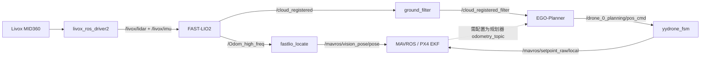

# 室内无人机自主飞行工作空间

面向 **ROS 2 Humble + PX4 + MAVROS + Livox MID360** 的室内无人机实验代码。仓库集成了 FAST-LIO2 激光惯性里程计、EGO-Planner 轨迹规划、MAVROS 定位桥接、自主飞行状态机、无人机模型描述和键盘/任务控制脚本。

> **状态说明**：这是实验性质的 ROS 2 源码集合，不是开箱即用的 PX4/Gazebo 仿真镜像。运行前需要按实际硬件、网络、PX4 参数、坐标系和 ROS 2 环境完成配置。状态机和部分控制脚本会请求 OFFBOARD、解锁并起飞，首次验证请使用仿真或拆桨测试。

## 功能一览

| 模块 | 功能 | 主要入口 |
|---|---|---|
| `yydrone_localization` + `livox_ros_driver2` + `fast_lio` | MID360 驱动、FAST-LIO2 里程计、MAVROS 视觉位姿桥接、地面点云滤波 | `ros2 launch yydrone_localization fastlio_launch.py` |
| `ego-planner-swarm` + `yydrone_navigation` | EGO-Planner 规划参数、轨迹服务器；可选 mock 地图 | `ros2 launch yydrone_navigation ego_planner_launch.py` |
| `yydrone_fsm` | PX4 OFFBOARD 状态机、自动起飞、接收规划命令并输出飞控设定值 | `ros2 launch yydrone_fsm fsm_launch.py` |
| `yydrone_control` | 起飞/悬停/航点任务、EGO 命令转 MAVROS、键盘控制脚本 | 见[控制脚本](#控制脚本) |
| `yydrone_description` | Iris URDF/Xacro、模型资源和 RViz 机器人状态展示 | `ros2 launch yydrone_description yydronemodel_launch.py` |
| `ego-planner-swarm` 仿真包 | EGO 仓库自带的软件仿真器和单机/集群示例 | 见[仿真运行](#仿真运行) |

## 数据流



规划器需要有效的里程计和环境点云/地图输入。`ego_planner_launch.py` 默认**不**启动 mock 地图；若仅做算法演示，可通过 `use_mockamap:=true` 启用内置 mock 地图节点。该启动文件本身不会启动 PX4、MAVROS、Gazebo 或 EGO 软件仿真器。

## 目录结构

```text
yix_drone_ws-new_u7_src/
├── yydrone_localization/       # FAST-LIO 到 MAVROS 的定位桥接、滤波和启动文件
├── yydrone_fsm/                # 自主飞行状态机及参数
├── yydrone_control/            # 手动控制和任务 Python 脚本
├── yydrone_description/        # Iris 模型、URDF/Xacro、RViz、world/model 资源
├── yydrone_navigation/         # EGO-Planner 集成启动文件
├── fast_lio/                   # FAST-LIO2
├── livox_ros_driver2-master/   # Livox ROS 2 驱动源码
├── ego-planner-swarm/          # EGO-Planner、消息定义和软件仿真相关包
├── ros2_keyboard_control.py    # 仓库根目录键盘控制脚本
└── ReadMe.md
```

## 环境与依赖

推荐环境：**Ubuntu 22.04、ROS 2 Humble、Python 3、colcon**。Windows 原生 PowerShell 不能直接运行这里的 ROS 2 Linux 节点；请在 Ubuntu、虚拟机或配置好的 WSL2 ROS 环境中构建。

主要依赖包括：

- ROS 2 Humble、`colcon`、`rosdep`
- ROS 消息与工具包：`rclcpp`、`rclpy`、`geometry_msgs`、`nav_msgs`、`sensor_msgs`、`tf2_ros`、`rviz2`、`xacro`
- PX4 通信：MAVROS 及 `mavros_msgs`，并按 MAVROS 文档安装 GeographicLib 数据
- 点云与数值库：PCL、`pcl_conversions`、Eigen3、OpenCV
- Livox SDK2，以及本仓库的 Livox ROS 2 驱动
- EGO-Planner 所需的 `quadrotor_msgs`、PCL、Eigen3 等依赖（仓库内含相关源码）

具体系统包名称可能随 ROS 2 安装方式变化。建议先安装 ROS 2 Humble 和 colcon，再按各依赖的官方安装说明准备 MAVROS、Livox SDK2 与系统开发库。

## 获取源码与构建

将本仓库完整放在 ROS 2 工作空间的 `src` 下。以下示例假设仓库目录名为 `yix_drone_ws-new_u7_src`：

```bash
mkdir -p ~/drone_ws/src
# 将本仓库完整克隆或复制到 ~/drone_ws/src/yix_drone_ws-new_u7_src
cd ~/drone_ws
```

### 1. 准备 Livox 驱动包

当前驱动目录提供的是 `package_ROS2.xml`，而不是 colcon 默认识别的 `package.xml`。在构建前执行：

```bash
cd ~/drone_ws/src/yix_drone_ws-new_u7_src/livox_ros_driver2-master
cp package_ROS2.xml package.xml
cp -r launch_ROS2 launch
```

还需要按 Livox SDK2 官方说明安装 SDK2。**不要在当前嵌套目录直接运行驱动自带的 `build.sh`**：该脚本会删除其假定位置下的 `build/`、`devel/`、`install/`，并假定驱动位于工作空间 `src/livox_ros_driver2`。此仓库把驱动嵌在项目子目录中，路径假设不匹配。

### 2. 安装 ROS 依赖并构建

```bash
source /opt/ros/humble/setup.bash
cd ~/drone_ws
rosdep install --from-paths src --ignore-src -r -y
colcon build --symlink-install
source install/setup.bash
```

如果依赖安装或构建报错，请先查看失败包缺少的 ROS 包/系统库，并确认 Livox SDK2 已安装。首次构建整个 EGO-Planner 和 FAST-LIO 工作空间可能需要较长时间。构建成功后，每个新终端都要执行：

```bash
source /opt/ros/humble/setup.bash
source ~/drone_ws/install/setup.bash
```

## 配置检查

运行前至少检查以下内容：

1. `yydrone_localization/config/fastlio_livox_params.yaml` 和 `fast_lio/config/mid360.yaml` 含有 `/home/lcx/...` 的示例 PCD 路径。将其改为本机有效路径，或在不加载已有地图时按 FAST-LIO 配置说明处理。
2. 核对 MID360 的设备 IP、主机网卡、Livox SDK2 连接配置、雷达与 IMU 外参、时间同步和数据话题。FAST-LIO 默认订阅 `/livox/lidar` 与 `/livox/imu`。
3. `fastlio_launch.py` 发布 `map -> odom` 和 `livox_frame -> base_link` 的静态 TF，当前外参为零值示例。真机必须按传感器安装位置校准，并确认 TF 方向与 FAST-LIO/PX4 坐标定义一致。
4. 检查 PX4 EKF2 的外部视觉/里程计融合配置、MAVROS 连接串口或 UDP 地址、飞控 failsafe、遥控器接管和急停方式。
5. 检查规划器的里程计话题、地图输入、飞行边界和速度/加速度限制。当前规划启动参数中的 odometry 默认值是 `Odometry`，真机使用前应确认和实际发布话题一致。

FAST-LIO 配置中 `pcd_save_en` 当前为 `true` 且 `interval: -1`，表示可能持续把数据写入同一个 PCD 文件；长时间运行前应评估存储和内存需求，并按任务需要修改。

## 启动流程

### 真机：定位、规划与状态机

以下假设 MAVROS 已通过另一终端连上 PX4，且传感器、外参、地图和 PX4 EKF 已验证。建议依次启动：

```bash
# 终端 1：Livox 驱动 + FAST-LIO2 + 定位桥接 + 点云滤波
ros2 launch yydrone_localization fastlio_launch.py
```

```bash
# 终端 2：EGO 规划器（真机默认不启动 mock 地图）
ros2 launch yydrone_navigation ego_planner_launch.py
```

```bash
# 终端 3：自主飞行状态机
ros2 launch yydrone_fsm fsm_launch.py
```

状态机代码会主动尝试切入 OFFBOARD、解锁，并爬升至默认 `1.0 m` 后等待规划命令；请先确认飞行区域清空、定位稳定、PX4 与 MAVROS 正常、遥控接管可用。若只想验证状态机程序的接口，不要直接连接已装桨真机。

启动前后可用这些命令检查系统：

```bash
ros2 node list
ros2 topic list
ros2 topic echo /mavros/state
ros2 topic echo /mavros/local_position/odom
ros2 topic echo /Odom_high_freq
ros2 topic echo /drone_0_planning/pos_cmd
```

### 定位模块单独运行

```bash
ros2 launch yydrone_localization fastlio_launch.py
```

主要话题：

| 话题 | 消息类型/用途 |
|---|---|
| `/livox/lidar` | MID360 点云输入 |
| `/livox/imu` | MID360 IMU 输入 |
| `/Odom_high_freq` | FAST-LIO 高频里程计 |
| `/cloud_registered` | FAST-LIO 配准点云 |
| `/cloud_registered_filter` | 地面滤波节点输出 |
| `/mavros/vision_pose/pose` | 提供给 MAVROS/PX4 的视觉位姿 |

## 仿真运行

`ego-planner-swarm` 中包含 EGO-Planner 自带的单机和集群软件仿真启动文件。构建成功并 source 工作空间后，可按需尝试：

```bash
ros2 launch ego_planner single_run_in_sim.launch.py
ros2 launch ego_planner swarm.launch.py
```

`yydrone_description` 的启动文件：

```bash
ros2 launch yydrone_description yydronemodel_launch.py
```

该启动文件只启动 URDF 模型的 `robot_state_publisher`、`joint_state_publisher` 和 RViz，不启动 Gazebo、PX4 SITL 或 MAVROS。EGO 自带的软件仿真器与 PX4 SITL/Gazebo 是不同的仿真环境，不要把这些启动命令视为完整的 PX4 SITL 仿真方案。

启用 EGO 集成启动文件的随机 mock 地图示例：

```bash
ros2 launch yydrone_navigation ego_planner_launch.py use_mockamap:=true
```

## 控制脚本

`yydrone_control` 中包含可单独运行的 Python ROS 2 节点：

```bash
cd ~/drone_ws/src/yix_drone_ws-new_u7_src
python3 yydrone_control/scripts/takeoff.py
python3 yydrone_control/scripts/offboard.py
python3 yydrone_control/scripts/move_front.py
python3 yydrone_control/scripts/integratemission.py
python3 yydrone_control/scripts/ego2mavros.py
python3 ros2_keyboard_control.py
```

`takeoff.py` 会执行起飞及预设航线流程；`offboard.py` 用于 OFFBOARD 悬停/控制；`move_front.py` 与 `integratemission.py` 执行各自脚本中定义的动作；`ego2mavros.py` 将 EGO `PositionCommand` 转成 MAVROS 设定值；根目录 `ros2_keyboard_control.py` 提供速度/位置键盘控制。运行前请检查每个脚本中的目标高度、航点、速度、模式切换和解锁逻辑。

键盘脚本使用 Linux 终端输入接口，应在真实终端中运行。不要同时启动多个会向同一组 MAVROS setpoint 话题发送命令的控制节点，否则设定值会互相覆盖。

## 关键接口与参数

| 项目 | 默认值/说明 |
|---|---|
| FAST-LIO 输入 | `/livox/lidar`、`/livox/imu` |
| FAST-LIO 里程计 | `/Odom_high_freq` |
| PX4 外部位姿 | `/mavros/vision_pose/pose` |
| EGO 规划命令 | `/drone_0_planning/pos_cmd` (`quadrotor_msgs/PositionCommand`) |
| FSM 目标输入 | EGO 规划命令；另有 `/move_base_simple/goal` 目标转发接口 |
| FSM 飞控输出 | `/mavros/setpoint_raw/local` |
| FSM 默认起飞高度 | `1.0 m` |
| FSM 默认控制频率 | `50 Hz` |
| 规划器 mock 地图 | 默认关闭；`use_mockamap:=true` 开启 |

FSM 参数见 `yydrone_fsm/config/fsm_params.yaml` 和 `yydrone_fsm/launch/fsm_launch.py`。注意 launch 文件会直接传入一组参数，修改 YAML 时请确认 launch 是否实际加载该文件；当前 `fsm_launch.py` 直接设置的参数优先生效。

## 安全与排错

- **真机上电前确认急停/遥控器接管有效。** 先在仿真或拆桨条件下验证控制链路，再进行低高度、低速度试飞。
- 检查 `/mavros/state` 是否已连接；检查 MAVROS 服务 `/mavros/cmd/arming` 与 `/mavros/set_mode` 是否可用。
- 若 OFFBOARD 被拒绝，检查设定值是否提前连续发布、频率是否满足 PX4 要求、模式名称是否正确，以及 PX4 failsafe/健康检查是否通过。
- 若 FAST-LIO 没有输出，检查 MID360 网络配置、`/livox/lidar` 和 `/livox/imu` 话题、时间戳、点云格式、外参及雷达固定情况。
- 若规划器没有轨迹，检查里程计和点云/地图输入、`odom_topic` 参数、坐标系、地图边界以及 `/drone_0_planning/pos_cmd` 是否发布。
- 发生异常时优先使用遥控器切换到安全模式或急停；不要依赖关闭 ROS 节点作为唯一的停机手段。

## 致谢

本仓库集成并修改了 FAST-LIO、Livox ROS Driver 2、EGO-Planner-Swarm 等开源项目。使用和再分发前，请分别遵守各子项目随附的许可证和引用要求。
